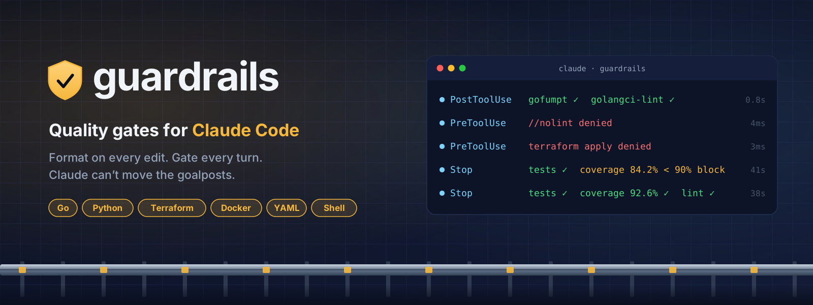

<p align="center">
  
</p>

<p align="center">
  <a href="https://github.com/rossedman/guardrails/actions/workflows/ci.yml"></a>
  <a href="https://github.com/rossedman/guardrails/releases"></a>
  <a href="https://pkg.go.dev/github.com/rossedman/guardrails"></a>
  <a href="https://goreportcard.com/report/github.com/rossedman/guardrails"></a>
  <a href="LICENSE"></a>
</p>

<p align="center">
  <b><a href="https://rossedman.github.io/guardrails/">Documentation</a></b> ·
  <a href="https://rossedman.github.io/guardrails/getting-started/">Getting started</a> ·
  <a href="https://rossedman.github.io/guardrails/configuration/">Configuration</a> ·
  <a href="https://rossedman.github.io/guardrails/guards/">Policy guards</a>
</p>

---

**Guardrails makes Claude meet your standards before it can call work done.**
It's one Go binary, shipped as a [Claude Code](https://claude.com/claude-code)
plugin, with a fast inner loop on every edit and a hard gate at the end of
every turn — for **Go, Python, Shell, YAML, Terraform and Docker**.

- **Fix, don't nag.** Every file Claude edits is formatted in place
  (gofumpt, ruff, shfmt, terraform fmt), then linted and type-checked, in
  about two seconds.
- **Gate every turn.** Before Claude can stop, touched code must build and
  pass its tests, reach **90% coverage** with a ratchet, cover **90% of the
  lines changed this session**, and pass every linter and scanner for its
  language.
- **Nothing to install.** ruff, mypy, shellcheck, yamllint, tflint, trivy,
  hadolint, golangci-lint and the rest are provisioned automatically:
  pinned versions, checksum-verified, downloaded on first use.
- **Claude can't move the goalposts.** New `//nolint`, `# noqa`, `t.Skip`,
  lowered thresholds and edits to the guardrail config are denied before
  they happen.
- **Dangerous commands need you.** `terraform apply`, force pushes, pushes
  to `main` and `--no-verify` are denied; registry pushes and non-dev
  cluster writes ask first.
- **Hands off, not stuck.** After three consecutive blocks the gate stops,
  summarizes what's left, and hands the turn back to you.

## What Claude sees

```text
guardrails: go gate failed (2 of 6 checks)

[coverage] 84.2% < 90.0% (touched: ./internal/sched, ./internal/api)
  internal/sched/queue.go:41  (*Queue).Drain  0/14 stmts
  internal/api/handler.go:88  decodeRequest  3/11 stmts
  fix: add table-driven tests for the functions above

[lint] 2 issues
  internal/api/handler.go:102:5  errcheck  Error return value of `w.Write` is not checked
  internal/sched/queue.go:17:1  revive  exported type Queue should have comment
  fix: fix each issue; suppression comments are not allowed

attempt 1 of 3 — run `guardrails gate --explain` for full output
```

## Quick start

In Claude Code:

```text
/plugin marketplace add rossedman/guardrails
/plugin install guardrails@guardrails
```

That's it. The plugin downloads its own binary and the
[tools it runs](https://rossedman.github.io/guardrails/tools/) on first use,
each pinned and checksum-verified; tools already on your `PATH` are used
first. Optionally, use the CLI too:

```bash
go install github.com/rossedman/guardrails/cmd/guardrails@latest
guardrails doctor   # check config and runtimes
guardrails init     # write .guardrails.yaml and .claude/rules/*.md
guardrails gate     # run the same gate Claude faces, on your changes
```

## How it works

| Event | What runs | On failure |
|---|---|---|
| **SessionStart** | Detect languages, prefetch their tools, inject the standards and coverage baseline | Context for Claude |
| **PreToolUse** | [Policy guards](https://rossedman.github.io/guardrails/guards/) on edits and shell commands | `deny` or `ask`, with a reason |
| **PostToolUse** | Auto-format, then fast lint and type checks on the edited file | Block with a `file:line` report |
| **Stop** | Build, tests, coverage, patch coverage, full lint, scanners, per language | Block; after 3 attempts, hand off to you |
| **SubagentStop** | The same gate, scoped to the subagent's files | Same as Stop |
| **SessionEnd** | Append a run record to `runs.jsonl` | — |

| Language | On edit | At Stop |
|---|---|---|
| [Go](https://rossedman.github.io/guardrails/go/) | gofumpt, goimports, go vet, golangci-lint | build, `go test -race`, coverage, golangci-lint, `go mod tidy`, govulncheck |
| [Python](https://rossedman.github.io/guardrails/python/) | ruff format + fix, ruff, mypy | pytest + coverage, mypy, ruff, `uv lock --check` |
| [Shell](https://rossedman.github.io/guardrails/shell/) | shfmt, shellcheck | shellcheck, shfmt diff |
| [YAML](https://rossedman.github.io/guardrails/yaml/) | yamllint, actionlint, kubeconform | the same, over every touched file |
| [Terraform](https://rossedman.github.io/guardrails/terraform/) | terraform fmt, tflint | init + validate, tflint, trivy, provider version constraints |
| [Docker](https://rossedman.github.io/guardrails/docker/) | hadolint | hadolint, digest-pinned bases, non-root `USER`, `docker build --check` |

Read more in [How it works](https://rossedman.github.io/guardrails/how-it-works/).

## Configuration

Zero config works. To tune, add `.guardrails.yaml` (Claude can't edit it):

```yaml
version: 1
mode: enforce            # enforce | warn
go:
  coverage:
    total: 90
    per_package_floor: 80
    ratchet: true
  patch_coverage: 90
  lint:
    on_edit: fast        # fast | full | off
gate:
  max_consecutive_blocks: 3
```

Unknown keys are an error, so a typo can never silently disable a check.
See the [configuration reference](https://rossedman.github.io/guardrails/configuration/).

## Status

Guardrails is **early (v0.2)**. All six language modules, tool
provisioning and the policy guards are implemented; mutation testing,
benchmarks and fuzzing are next on the
[roadmap](https://rossedman.github.io/guardrails/roadmap/). Guardrails
holds itself to its own gate in CI.

## Contributing

Contributions are welcome — see [CONTRIBUTING.md](CONTRIBUTING.md). Please
report security issues privately as described in [SECURITY.md](SECURITY.md).

## License

[MIT](LICENSE) © Ross Edman
