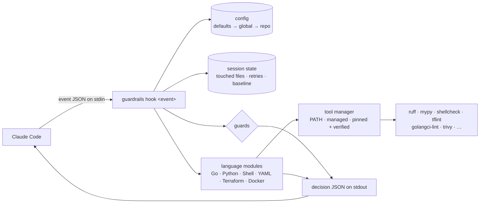

# How it works

Guardrails is one Go binary, `guardrails`, that handles every Claude Code
hook event through `guardrails hook <event>`. The plugin's `hooks/hooks.json`
maps events to it, so there is one codebase, one config and one cache.



Each hook call is a short-lived process: read the event, load config and
session state from the plugin data directory, run only the modules whose
files match, and print one JSON decision.

## Design principles

**Two loops, two budgets.** Per-edit checks (PostToolUse) are scoped to one
file's package and finish in about two seconds. Expensive checks (full
tests, coverage, vulnerability scans) run once, at Stop.

**Fix, don't nag.** Anything deterministic is auto-fixed in place (gofumpt,
goimports). Claude only hears about problems it has to reason about.

**Scope to what Claude touched.** The session tracks every file Claude
edits; the gate checks those files and their packages. Pre-existing debt in
untouched code never blocks.

**Gates fail closed.** Blocking hooks set `onFailure: "block"`, and the
binary exits 2 on internal errors during blocking events, so a crash or a
hung linter stops work instead of silently passing.

**Policy via permissions, feedback via hooks.** Hard denies belong in
`permissions.deny` too (`guardrails init` prints a block for that); the
hooks add the reasoning and a message Claude can act on.

**Output is for a model.** Short, structured, `file:line` first, one fix
hint per group, capped at 4,000 characters — well under the 10,000-character
hook output limit.

**Claude can't move the goalposts.** The config, the hook settings and
suppression comments are protected by PreToolUse guards.

**Dogfood.** The binary holds itself to its own gate in CI: 90% coverage,
race tests and golangci-lint.

## State

State lives under `${CLAUDE_PLUGIN_DATA}` (or `~/.local/share/guardrails`
outside Claude Code):

| Path | Contents |
|---|---|
| `sessions/<id>/state.json` | Touched files (per agent), consecutive Stop blocks, base commit, coverage baseline, issues already reported |
| `sessions/<id>/last-*-report.txt` | Full, untruncated reports |
| `repos/<hash>.json` | Per-repo coverage by package and the last gate summary (for the ratchet and status line) |
| `cache/<hash>.json` | Content-addressed results of per-edit checks |
| `runs.jsonl` | One line per gate run and per session, for analytics |

Claude Code runs matching hooks in parallel, so every read-modify-write of
session state holds a per-session lock file.

## Repository root

The repo root is taken from the event's `cwd` (resolved to the git top
level), not `CLAUDE_PROJECT_DIR`, so hooks follow Claude into worktrees.

## Language modules

Each language implements one interface, so adding a language is one package:

```go
type Module interface {
    Name() string
    Enabled(cfg config.Config) bool
    Match(path string) bool
    Tools() []Tool
    Standards(cfg config.Config) string
    Fix(ctx context.Context, env Env, files []string) FixResult
    Check(ctx context.Context, env Env, files []string) []feedback.Check
    Gate(ctx context.Context, env Env, in GateInput) GateResult
}
```

Six modules ship today: [Go](go.md), [Python](python.md), [Shell](shell.md),
[YAML](yaml.md), [Terraform](terraform.md) and [Docker](docker.md). The
tools they run are [provisioned automatically](tools.md).
