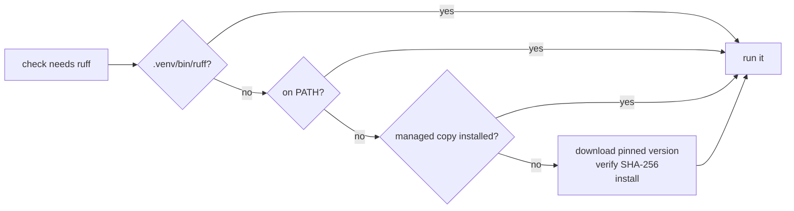

# Tool provisioning

Guardrails orchestrates a lot of tools — ruff, mypy, shellcheck, shfmt,
yamllint, actionlint, kubeconform, terraform, tflint, trivy, hadolint,
golangci-lint and more. **You don't install any of them.** Guardrails
provisions pinned, checksum-verified copies on demand, so a host needs
little more than the language runtime you already code in.

## How a tool is found

For every tool, Guardrails tries, in order:

1. **The project's own environment.** Python tools run from the project's
   `.venv` when it has them, so pytest and mypy see your dependencies.
2. **Your `PATH`.** If you installed a tool yourself, that copy wins (unless
   `tools.prefer: managed`).
3. **The managed copy.** The pinned version in
   `${CLAUDE_PLUGIN_DATA}/tools/<name>/<version>/`, installed on first use.



## Never inside the edit budget

Per-edit checks have a two-second budget, so they never wait on a download:

- **SessionStart** detects which languages the repo uses and starts a
  background install of the tools they need. You see one line:
  `installing pinned tools in the background: ruff, mypy, shellcheck`.
- **PostToolUse** skips a check whose tool is still installing, rather than
  blocking Claude for something that isn't its fault.
- **Stop** waits for any install to finish, so the gate always runs in full.

## Where tools come from

Every tool is pinned in
[`internal/tools/tools.yaml`](https://github.com/rossedman/guardrails/blob/main/internal/tools/tools.yaml)
and locked in `tools.lock.json`, which records the exact URL and SHA-256 of
the artifact for each platform (Linux and macOS, amd64 and arm64). Downloads
whose checksum doesn't match are rejected.

| Source | Used for | Integrity |
|---|---|---|
| Release archive | shellcheck, actionlint, kubeconform, hadolint, tflint, trivy, terraform, tofu, golangci-lint, gofumpt | SHA-256 pinned in the lock |
| PyPI wheel | uv, shfmt | SHA-256 pinned in the lock, cross-checked against PyPI's digest |
| uv | ruff, mypy, yamllint | A hash-pinned requirements file per tool, installed with `uv pip install --require-hashes` into an isolated venv |
| `go install` | goimports, govulncheck | The Go checksum database |

uv also provides a Python interpreter for Python-based tools when the host
has none.

The lock is generated, never hand-edited: `go run ./internal/tools/lockgen`
downloads every artifact, hashes it and checks the executable is inside. A
weekly workflow regenerates it and opens a pull request, and CI installs
every tool on all four platforms so a broken upstream artifact fails there,
not on your machine. (It has already caught one: a corrupt macOS hadolint
wheel on PyPI.)

## What you still need

| Need | When |
|---|---|
| Go | Go repositories (to build and test) — the tools around it are managed |
| A Python project environment | Running your tests; Guardrails uses `uv run` or `.venv` |
| A Docker daemon | Only for the optional `docker build --check`; every other Docker check works without one |
| Network access on first use | To download tools; afterwards everything is cached |

## Configuration

```yaml
tools:
  install: auto      # auto | never — never uses only what's installed
  prefer: path       # path | managed — managed always uses the pinned versions
```

Use `prefer: managed` when you want results that match CI and teammates
exactly, regardless of what's on each machine. Use `install: never` on
air-gapped machines; missing tools are then reported to you, and required
ones fail the gate.

## Commands

```bash
guardrails tools list            # every tool, pinned version, where it resolves
guardrails tools install         # install everything for this platform
guardrails tools install ruff    # install specific tools
guardrails tools path shellcheck # print the command Guardrails will run
```

```text
TOOL           PINNED     SOURCE   RESOLVES TO
actionlint     1.7.12     archive  managed
golangci-lint  2.15.0     archive  /usr/local/bin/golangci-lint (PATH)
mypy           2.4.0      uv       managed
ruff           0.17.1     uv       managed
shellcheck     0.11.0     archive  managed
terraform      1.16.6     archive  managed
...
```

## Why not containers?

Running each tool in a container sounds simpler, but it breaks the inner
loop: container start-up eats most of the two-second per-edit budget, it
needs a running daemon, and bind mounts make paths, permissions and caches
awkward. Static binaries and uv-managed venvs start in milliseconds and work
the same on every machine.
